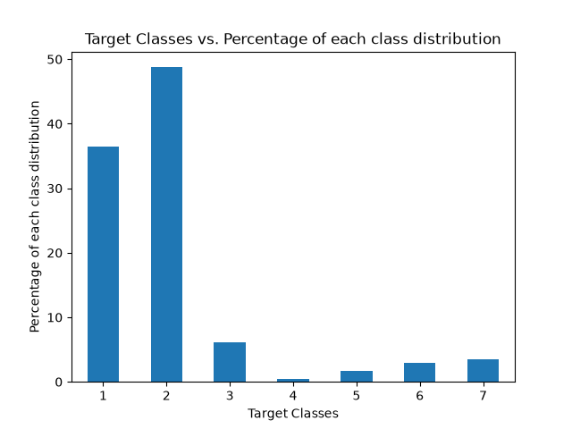

# Forest Cover Type Classification with Deep Neural Networks

A hands-on project where I apply the techniques from the first two courses of Andrew Ng's Deep Learning Specialization (regularization, optimization, batch normalization, hyperparameter tuning) to a real, large, imbalanced multi-class problem, using TensorFlow/Keras.

> **Status:** work in progress. Data exploration is done; baselines and neural network experiments are next.

## Problem

Predict the forest cover type (7 classes) of a 30m x 30m patch of land from cartographic variables such as elevation, slope, distance to water/roads, and soil type.

- **Dataset:** [UCI Covertype](https://archive.ics.uci.edu/dataset/31/covertype) (581,012 samples, 54 features)
- **Features:** 10 numeric, 4 binary wilderness-area columns, 40 binary soil-type columns
- **Target:** `Cover_Type`, classes 1 to 7

## Goals

1. Build a fair comparison between classic baselines and a deep neural network.
2. Measure the effect of each training technique with a clean ablation study, instead of reporting only one final model.
3. Handle class imbalance correctly (stratified split, macro F1, per-class recall).
4. Serve the final model through a small API.

## Findings so far

Notebook `01_data_exploration` shows:

- The data is clean: no missing values, all columns are integers.
- The classes are **strongly imbalanced**. Class 2 is 48.8% and class 1 is 36.5% of the data, while class 4 is only 0.47%. A model that always predicts class 2 already gets about 49% accuracy, so accuracy alone is not a good metric here.
- The numeric features have very different scales (for example `Elevation` is in the thousands while `Slope` is below 70), so the 10 numeric features need standardization. The binary columns are left unchanged.



## Roadmap

- [x] `01_data_exploration`: data quality, class distribution, feature scales
- [ ] `02_baselines`: label shift (1-7 to 0-6), stratified train/dev/test split, normalization, majority-class baseline, Logistic Regression, tree-based model
- [ ] `03_nn_experiments`: ablation study with Keras
  - [ ] Network depth and He initialization
  - [ ] Regularization: none vs. L2 vs. Dropout
  - [ ] Optimizers: SGD vs. Momentum vs. Adam, and mini-batch sizes
  - [ ] Learning rate decay
  - [ ] Batch Normalization
  - [ ] Random search over hyperparameters
- [ ] Final evaluation on the test set: macro F1, per-class recall, confusion matrix, error analysis
- [ ] FastAPI endpoint for the final model

## Project structure

```
.
├── data/              # raw dataset (not tracked by git)
├── notebooks/         # numbered notebooks, one task each
├── src/               # reusable code (data loading, models, training)
├── results/           # figures and result tables
├── models/            # saved models (not tracked by git)
└── requirements.txt   # main dependencies (pinned versions)
```

## Setup

The project uses **Python 3.11** (needed for the TensorFlow version used here).

```bash
# 1. Create and activate a virtual environment
# Windows:
py -3.11 -m venv venv
venv\Scripts\activate
# Linux / macOS:
python3.11 -m venv venv
source venv/bin/activate

# 2. Install dependencies
python -m pip install --upgrade pip
pip install -r requirements.txt
```

### Data

The dataset is not included in the repository.

1. Download the Covertype dataset from the [UCI page](https://archive.ics.uci.edu/dataset/31/covertype).
2. Extract the zip and put the file `covtype.data.gz` inside the `data/` folder. Do not unzip the `.gz` file; pandas reads it directly.

The raw file has no header, so the column names are defined in the notebooks following the UCI documentation.

## Reproducibility

A fixed random seed is used for all splits and training runs. Package versions are pinned in `requirements.txt`.

## Dataset citation

Blackard, J. (1998). *Covertype*. UCI Machine Learning Repository. https://doi.org/10.24432/C50K5N